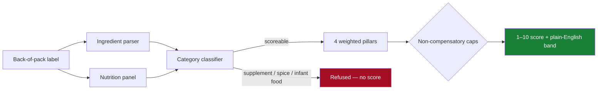

<div align="center">

# India Food Health Index

**A 1–10 health score for packaged food sold in India — computed, not guessed.**

Every point traces to a published source. Every refusal has a reason. Every number that *isn't* sourced is labelled as a judgement call.

[](https://www.python.org/)
[](https://streamlit.io/)
[](tests/test_scoring.py)
[](https://opendatacommons.org/licenses/odbl/1-0/)
[](#where-the-data-comes-from)

### [**Launch the live app**](https://india-packaged-food-analysis.streamlit.app/)

**[Full project plan](../docs/india-food-health-index-plan.md) · [Report a bug](https://github.com/SahilYadav-op/india-food-health-index/issues)**

</div>

---

## Problem statement

Walk down any Indian supermarket aisle and the front of the pack is doing everything it can to *not* tell you the truth. **"No added preservatives."** **"Baked, not fried."** **"Made with real fruit."** **"100% natural."** None of that is regulated the way the actual nutrition panel is — front-of-pack claims are marketing copy, and Indian FSSAI rules don't require a warning label the way Chile, Mexico or Israel do. The only place the real story lives is the small, back-of-pack ingredient list and nutrition table, printed in size-6 font, in a format most people never learn to read.

The result: a biscuit branded as a "digestive" health food can carry more saturated fat and sugar per 100 g than a regular cream biscuit, and nothing on the front of the pack tells you that. A "no added MSG" claim can be true and completely irrelevant, because the product's real problem is sodium. A snack can be positioned as a protein food while being ultra-processed with five cosmetic additives.

**This project exists to close that gap** — to take the one part of the label that can't legally lie (the mandatory nutrition panel and ingredient list) and turn it into a single number you can actually compare across products, backed by the same nutrient-science models used internationally, so a shopper doesn't have to take a brand's marketing at its word.

---

## What this actually does

You type a product name — `parle-g`, `kurkure`, `nutrichoice` — and get a **1–10 score**, a plain-English label ("Very poor", "Reasonable", "Excellent"), and a full breakdown of *why*: which nutrients are the problem, whether it's ultra-processed, which additives are in it and whether the evidence actually says they're harmful, and whether the WHO would let it be marketed to children.

It is deliberately **not** a magic AI verdict. It is four published nutrient-science models, re-implemented from their primary sources, combined with a non-compensatory scoring rule so a product can't buy back a good score with added protein.

```
Britannia Nutrichoice Digestive → 2/10  "Very poor"
  481 kcal · 10.4 g saturated fat · 13.1 g sugar · 0.92 g salt per 100 g
  Breaches 4 WHO SEARO thresholds. 7.3 g fibre only earns 4 points against 23.

Kurkure → 3/10  "Poor"
  Contains MSG + ribonucleotides → additive pillar: 100/100, ZERO penalty.
  Still scores 3/10 — on sodium, fat, and ultra-processing. Not on scaremongering.
```

---

## Table of contents

- [Problem statement](#problem-statement)
- [How it scores a product](#how-it-scores-a-product)
- [The four pillars](#the-four-pillars)
- [Quick start](#quick-start)
- [Tech stack](#tech-stack)
- [Where the data comes from](#where-the-data-comes-from)
- [What it refuses to do — on purpose](#what-it-refuses-to-do--on-purpose)
- [Validation](#validation)
- [Bugs this project actually caught itself](#bugs-this-project-actually-caught-itself)
- [Which numbers here are NOT sourced](#which-numbers-here-are-not-sourced)
- [Repo layout](#repo-layout)
- [Roadmap](#roadmap)
- [License & attribution](#license--attribution)
- [Author](#author)

---

## How it scores a product



A product is **refused, not force-scored**, when scoring it would mean guessing: incomplete nutrition panel, or a category where a per-100g number is meaningless (supplements, spices, infant formula). **38.5% of the harvested corpus is refused** — that's a feature, not a gap.

---

## The four pillars

| Pillar | Weight | What it is | Why this weight |
|---|---:|---|---|
| **Nutrients** | 50% | Nutri-Score 2023 algorithm (general / beverage / fats-oils-nuts variants) | The only component with **prospective cohort validation** — EPIC (n=471,495) found HR 1.07 for total cancer across quintiles of the underlying index |
| **Processing** | 25% | NOVA classification — ultra-processed marker detection | Large, consistent observational evidence; one Moderate-GRADE cell (T2D, RR 1.12 per 10pp UPF share) |
| **Additives** | 15% | 173-entry evidence-graded register (EFSA / JECFA / IARC positions) | Real regulatory concern, mostly *limited*-grade evidence — weighted accordingly, not by internet alarm |
| **WHO SEARO screen** | 10% | Pass/fail per-nutrient thresholds, written for South-East Asia, pilot-tested in India | Exists to **cap**, not to add points — see below |

### The caps are the actual point

Every star-rating system criticised in India — including FSSAI's own withdrawn Indian Nutrition Rating — shares one flaw: a product can offset a serious excess with protein and fibre and still look respectable. Here, a WHO breach lowers the **ceiling** instead of subtracting points:

| Trigger | Score ceiling |
|---|---:|
| 1 WHO SEARO threshold breached | 7 |
| 2 breached | 5 |
| 3+ breached | 4 |
| A SEARO blanket exclusion (trans fat > 1% energy, or any non-sugar sweetener) | 3 |
| Ultra-processed (NOVA group 4) | 8 |
| Contains an EU child-behaviour-warning colour | 6 |
| Nutri-Score E | 4 |

Caps only ever pull the score **down**. The app shows the uncapped number alongside so the mechanism stays visible instead of hidden.

---

## Quick start

```bash
git clone https://github.com/SahilYadav-op/india-food-health-index.git
cd india-food-health-index
pip install -r requirements.txt
streamlit run app.py
```

The scored dataset (`data/products.parquet`, 3,386 products) ships in the repo — no setup needed to try it. To rebuild from live data instead:

```bash
python pipeline/harvest_off.py --max-products 4000   # cached + rate-limited, safe to re-run
python pipeline/build_dataset.py --report
```

Run the tests:

```bash
python tests/test_scoring.py     # zero-dependency, works without pytest
```

```
40/40 passed
```

---

## Tech stack

| Layer | Choice | Why |
|---|---|---|
| Language | **Python 3.11** | Every dependency below runs cleanly here |
| Data source | **Open Food Facts API** (v2 + search-a-licious) | The only source that is simultaneously open-licensed, barcode-keyed, and India-specific |
| HTTP client | `requests` + disk-cached JSON | One request per barcode, never repeated — a re-run costs zero network calls |
| Data processing | `pandas` | Repair/validate/tier pipeline over ~3.4k rows — no need for anything heavier |
| Storage | **Parquet** (`pyarrow`) | List-typed columns (ingredients, additive codes) round-trip natively; 776 KB for the whole scored dataset |
| Scoring engine | **Pure Python, zero ML** | Every score is a deterministic function of published thresholds — auditable line by line, no model weights to distrust |
| Web app | **Streamlit** | One file, `st.cache_data` for the dataset, deep-linkable via `st.query_params` |
| Testing | Hand-rolled + `pytest`-compatible | 40 regression tests, each tied to a real bug this project actually hit |
| Hosting | **Streamlit Community Cloud** | Free tier, GitHub-connected auto-redeploy on push |
| Version control | **Git + GitHub CLI (`gh`)** | Repo created and pushed straight from the terminal |

No LLM is involved in computing a score. The only place AI touches this project is the *research* that grounded the design — see below.

---

## Where the data comes from

**Nothing is scraped.** All 3,413 products come from [Open Food Facts](https://world.openfoodfacts.org), a crowd-sourced, ODbL-licensed open database — the same data source Yuka and FoodSwitch build on.

Retail sites were deliberately **not** touched:

| Site | Why not |
|---|---|
| Amazon.in | `robots.txt` explicitly bans data-mining user agents by name |
| BigBasket | Returns `403` even when fetching `robots.txt` itself |
| Blinkit / Zepto | 403s on product pages / serves an empty client-rendered shell |

Open Food Facts' India subset holds **22,170 products**; this project harvested the **3,413** carrying a usable energy value, via the documented `/api/v2/product/{barcode}` endpoint, at 15 requests/minute (their published limit), with every response cached to disk so re-running the harvester costs nothing.

**The honest constraint:** only **21.4%** of OFF's India subset has both a complete nutrition panel *and* a complete ingredient list. That gap — not the scoring model — is what actually bounds this project.

---

## What it refuses to do — on purpose

- **Never calls anything toxic.** No packaged food sold legally in India is toxic at normal intake. Every model here is validated against dietary *patterns*, not single products. The worst band says *"harmful as a regular habit"* — strong, and defensible.
- **Never penalises MSG.** "Chinese restaurant syndrome" traces to a 1968 letter later reported to be a prank; double-blind trials never reproduced it. MSG is 12.3% sodium against table salt's 39.3% — using it *lowers* total sodium. Penalty: **zero**, deliberately, alongside saccharin and food-grade carrageenan.
- **Never double-counts palm oil.** Its LDL effect is fully explained by its saturated-fat content, which the nutrient panel already penalises.
- **Never scores what shouldn't be scored.** Supplements, spices, infant formula, cooking ingredients — refused with a stated reason, not force-fitted onto a scale where they'd flatter to deceive.
- **Never guesses.** Incomplete nutrition data → no score. Not a low score. No score.

---

## Validation

| Comparison | n | Result |
|---|---:|---|
| Nutri-Score grade vs Open Food Facts | 1,730 | **90.8% exact · 97.9% within one grade** |
| NOVA group vs Open Food Facts | 1,895 | **85.3%** |
| Additive-code recall vs Open Food Facts | 2,053 | **81.1%** *(and finds codes OFF's own taxonomy misses)* |
| Ingredient-parser failure rate | 2,053 | **0%** |

Read this correctly: these numbers are **concordance with a crowd-sourced database**, not ground-truth accuracy. The honest next step — a hand-transcribed 200–300-label gold set — is unbuilt and documented as such in the [plan](../docs/india-food-health-index-plan.md#62-gold-set-accuracy-must-do).

---

## Bugs this project actually caught itself

Building the validation gate found real, specific defects — kept here because they're more informative than a clean-looking demo:

| # | Bug | What it did |
|---|---|---|
| 1 | `INS 472e` parsed as `e472` | Silently renamed DATEM to a *different* additive |
| 2 | `[INS 503(ii), 500(ii)]` shared-prefix run | Turned sodium bicarbonate into sodium carbonate |
| 3 | `NaN != None` in Parquet | Products with **zero** nutrition data scored a perfect **A** |
| 4 | Colas tagged `carbonated-waters` | Thums Up / Pepsi / Mountain Dew classified as *plain water*, scoring 10/10 |
| 5 | `non-alcoholic-beverages` matched an `alcohol` rule | Every cola briefly classified as alcohol |
| 6 | Substring match on `"atta"` | `Khatta Meetha` (a namkeen) misfiled as flour |
| 7 | Missing pillars defaulted to 100/100 | *Less* data quietly meant a *higher* score |
| 8 | Fibre counted in the mass-budget check | 121 false data-quality failures, concentrated on the healthiest items — atta, oats, millet |
| 9 | Typos charged as hazards | 488 valid, ordinary additives penalised under a rule meant for label typos |
| 10 | First-match-wins category tags | `Kurkure Masala Munch` (4 votes for "namkeen") filed as a *biscuit* on one weaker tag |

Every row above has a regression test in [`tests/test_scoring.py`](tests/test_scoring.py).

---

## Which numbers here are NOT sourced

Four constants are judgement calls, not published values — and are declared as such rather than dressed up as objective:

- the pillar weights (50/25/15/10)
- the 25-points-per-WHO-breach conversion
- the composite → 1–10 band edges
- the cap ceilings themselves

WHO SEARO is a **pass/fail** model and publishes no severity scale — any conversion into a graded number requires an unsourced choice. These belong in an ablation study (see the [plan, §6.4](../docs/india-food-health-index-plan.md#64-ablation-must-do)), not in a claim of pure objectivity.

---

## Repo layout

```
india-food-health-index/
├── app.py                      Streamlit app — 5 views, deep-linkable
├── requirements.txt            4 pins, Streamlit-Cloud-safe
├── data/
│   ├── products.parquet        3,386 validated, scoreable products
│   ├── quarantine.parquet      15 unrepairable records, kept for audit
│   └── validation_report.json  coverage / tier / issue counts
├── pipeline/
│   ├── harvest_off.py          Open Food Facts harvester — cached, rate-limited
│   └── build_dataset.py        repair → validate → tier
├── scoring/
│   ├── categories.py           24 categories; 6 refuse to score
│   ├── ingredients.py          Indian-label ingredient parser
│   ├── additives.py            173-entry evidence-graded additive register
│   ├── nutrients.py            Nutri-Score 2023 + WHO SEARO + FSSAI %RDA
│   ├── processing.py           NOVA classification + UPF markers
│   └── index.py                4 pillars → non-compensatory caps → 1-10
└── tests/test_scoring.py       40 tests, each tied to a real bug found
```

## Roadmap

- [ ] Hand-labelled gold set (200–300 physically-transcribed labels)
- [ ] Ablation study over the four unsourced constants
- [ ] OCR pipeline for the ~2,500 OFF India products that have a label photo but no parsed text
- [ ] Expert-panel comparison (Spearman ρ + inter-rater reliability)

Full detail: [`docs/india-food-health-index-plan.md`](../docs/india-food-health-index-plan.md)

## License & attribution

Product data from **Open Food Facts**, licensed under the **Open Database License (ODbL) 1.0** — any redistribution of this dataset or a derivative must credit Open Food Facts and remain under ODbL. Images CC-BY-SA 3.0.

## Author

**Sahil Yadav**

[](https://github.com/SahilYadav-op)
[](https://www.linkedin.com/in/sahilgod01/)

---

<div align="center">

**Not medical advice.** A student research project that rescales published nutrient-profiling models. It does not diagnose, treat, or make disease claims — and no single food is good or bad on its own.

</div>
